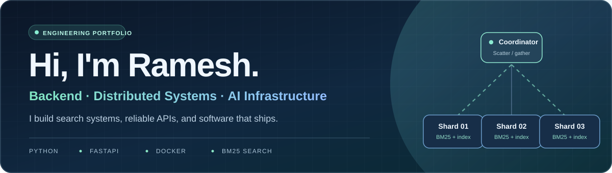
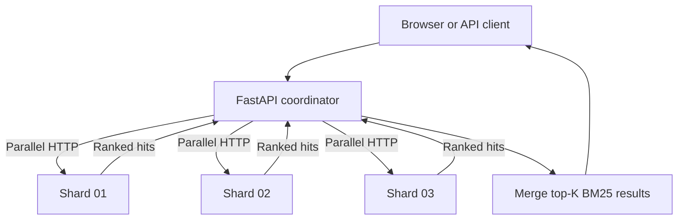

  

  
  &nbsp;
  

  <strong>One hand-built search engine. Two public, working applications.</strong> 
  Building dependable backends, retrieval infrastructure, and practical AI foundations.

---

## 🚀 Featured projects

<table>
  <tr>
    <td width="50%" valign="top">
      <h3>01 · Distributed Search Engine</h3>
      
<strong>The search infrastructure.</strong> Custom inverted index and BM25 ranking, with a FastAPI coordinator distributing queries across three HTTP shard processes.

      
🔍 Ranked results &nbsp;·&nbsp; 🧩 Scatter–gather &nbsp;·&nbsp; 🛡️ Circuit breakers

      
<a href="https://distributed-search-portfolio-demo.onrender.com/"><strong>↗ Live demo</strong></a> &nbsp;·&nbsp; <a href="https://github.com/Ramesh-codex/distributed-search-engine/tree/deployment-demo">Source code</a> &nbsp;·&nbsp; <a href="https://distributed-search-portfolio-demo.onrender.com/docs">API docs</a>

    </td>
    <td width="50%" valign="top">
      <h3>02 · Developer Documentation Search</h3>
      
<strong>A real application on top of that engine.</strong> Search <strong>188 indexed excerpts</strong> from 20 official FastAPI, HTTPX, and Docker documentation pages.

      
📚 Source filters &nbsp;·&nbsp; 🔗 Original documentation links &nbsp;·&nbsp; ⚡ BM25 results

      
<a href="https://distributed-search-portfolio-demo-rvv6.onrender.com/"><strong>↗ Live app</strong></a> &nbsp;·&nbsp; <a href="https://github.com/Ramesh-codex/distributed-search-engine/tree/developer-docs-search">Source code</a> &nbsp;·&nbsp; <a href="https://distributed-search-portfolio-demo-rvv6.onrender.com/docs">API docs</a>

    </td>
  </tr>
</table>

> **Try them:** Search `circuit breaker` in the engine demo, or `dependency injection` in DevDocs Search. Both run publicly over HTTPS. Free hosting may need a cold start after inactivity.

## ⚙️ Under the hood

- **Retrieval:** Hand-written inverted index and BM25 scoring rather than a managed search engine.
- **Distribution:** Consistent-hash document partitioning, parallel HTTP scatter–gather, and top-K result merging.
- **Resilience:** Circuit breakers, timeouts, and explicit degraded/partial-result reporting.
- **Delivery:** Reproducible Docker builds, prebuilt indexes, GitHub Actions integration tests, and Render deployments.

<strong>▸ View the search architecture</strong>

 

## 🧰 Technologies I use

  
  
  
  
  
  
  
  

## ✅ Tested and deployed

Both applications have passed GitHub Actions Docker and HTTP integration checks. The documentation search application also passed a **public HTTPS test** covering real FastAPI, HTTPX, and Docker searches across all three shards.

**[View public API verification ↗](https://github.com/Ramesh-codex/distributed-search-engine/actions/runs/41043841430)** &nbsp;·&nbsp; **[Read implementation notes ↗](https://github.com/Ramesh-codex/distributed-search-engine/tree/developer-docs-search/docs_app)**

**Engineering note:** The hosted applications run three independent HTTP shard *processes* within one free Render instance—not on three separate machines. Their small demo datasets and hosting conditions are different from the original engine's larger benchmark corpus.

---

<strong>Interested in backend engineering, distributed systems, search infrastructure, and AI platform roles.</strong> 
<a href="https://github.com/Ramesh-codex/distributed-search-engine">Explore my engineering work ↗</a>

